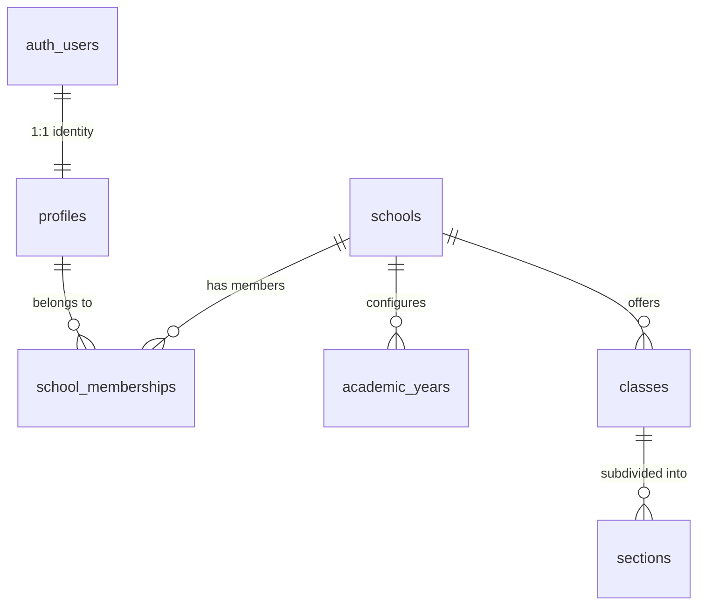

# EduNexa ERP — Technical Architecture

## 1. System Overview & Technology Stack

The platform is designed as a modern, full-stack multi-tenant SaaS application leveraging:

| Layer | Technology | Version / Specification | Justification |
| :--- | :--- | :--- | :--- |
| **Framework** | Next.js (App Router) | 15.2.0 | High-performance React framework with native Server Components, streaming, and Route Handlers. |
| **Language** | TypeScript | Strict Mode (`^5.7.3`) | Full type safety, strict null checking, no implicit `any`, zero compiler warnings. |
| **Frontend Styling** | Tailwind CSS & CSS Variables | 3.4.x | Utility-first responsive styling with theme-based design tokens matching shadcn/ui patterns. |
| **Iconography** | Lucide React | Latest | Consistent, lightweight, accessible SVG icon library. |
| **Database & Auth** | Supabase & PostgreSQL | Supabase SSR (`^0.5.2`) | Enterprise relational database with Row Level Security (RLS) for tenant isolation. |
| **Data Validation** | Zod | `^3.24.2` | Runtime environment and schema validation. |
| **Unit Testing** | Vitest & React Testing Library | `^3.0.6` | Fast in-memory testing for business logic, utilities, and RBAC rules. |

---

## 2. Directory & Modular Organization

The codebase follows a domain-driven, feature-sliced architecture keeping business logic separate from UI presentation:

```
src/
├── app/                        # Next.js App Router entry points & route groups
│   ├── (auth)/                 # Authentication routes (Phase 1)
│   ├── (dashboard)/            # Protected role dashboards (Phase 1)
│   ├── api/                    # Route Handlers & Webhooks
│   │   └── health/route.ts     # Healthcheck endpoint
│   ├── globals.css             # Tailwind CSS tokens & base styles
│   ├── layout.tsx              # Root HTML/Body shell
│   └── page.tsx                # Development foundation dashboard
├── components/
│   ├── layouts/                # Shared page shells (AppShell, DashboardLayout)
│   ├── shared/                 # Common elements (Header, Footer, BrandLogo)
│   └── ui/                     # Atomic primitives (Button, Card, Badge, Table)
├── config/
│   ├── app.ts                  # Application metadata, version, CBSE norms
│   ├── roles.ts                # Central role metadata and permission rules
│   └── site.ts                 # Site navigation configuration
├── features/                   # Domain-driven feature modules
│   ├── auth/                   # Authentication logic, hooks, and session helpers
│   ├── schools/                # Multi-tenant school profiles and context
│   ├── students/               # Student admission and record contracts
│   ├── teachers/               # Faculty and subject teacher allocations
│   ├── academics/              # Academic years, classes, sections, and subjects
│   ├── attendance/             # Daily student attendance registers
│   ├── assignments/            # Homework and project submissions
│   ├── examinations/           # Exam timetables, marks entry, and report cards
│   └── notices/                # School announcements and broadcasts
├── hooks/                      # Shared custom hooks (useMounted, etc.)
├── lib/
│   ├── supabase/               # Supabase SSR clients (browser, server, admin, middleware)
│   ├── utils/                  # Utility functions (cn, formatDate, getInitials)
│   └── validations/            # Zod schemas (environment variable validation)
├── middleware.ts               # Next.js edge session refresher
└── types/                      # Central TypeScript interfaces & Supabase DB types
    ├── database.ts             # Strongly typed PostgreSQL tables and RPCs
    ├── index.ts                # Aggregated domain models
    └── roles.ts                # Role enums, resource actions, and authorization contexts

supabase/
├── migrations/                 # PostgreSQL migrations executed in order
│   └── 20261101000000_initial_schema.sql
├── seed.sql                    # Development seed data for local testing
└── config.toml                 # Supabase CLI configuration

docs/                           # Architecture, database, and process documentation
tests/                          # Vitest unit and integration test suites
```

---

## 3. Multi-Tenant Isolation Model

### Tenancy Principles
1. **Shared Database, Isolated Rows:**
   All schools share the same PostgreSQL database instance. Data isolation is strictly enforced via PostgreSQL Row Level Security (RLS) policies based on `school_id`.
2. **Disjoint Identities:**
   User profiles (`profiles`) are independent of schools. A user can be associated with multiple schools via the `school_memberships` table.
3. **No Unchecked Role Strings:**
   Role assignments are validated through an enumerated `user_role` type (`PRINCIPAL`, `ADMIN`, `TEACHER`, `STUDENT`, `PARENT`) stored in `school_memberships`.



---

## 4. Server-Side Supabase Client Architecture

Supabase clients are created via `@supabase/ssr` to ensure secure, cookie-based session persistence across Next.js 15 Server Components and Route Handlers:

- `src/lib/supabase/client.ts`: Singleton browser client for client components.
- `src/lib/supabase/server.ts`: Server client accessing cookies via `await cookies()`.
- `src/lib/supabase/server.ts (createAdminClient)`: Service-role client for background jobs and administrative operations (never exposed to browser).
- `src/lib/supabase/middleware.ts`: Token refresher invoked by `src/middleware.ts` on each incoming request.
