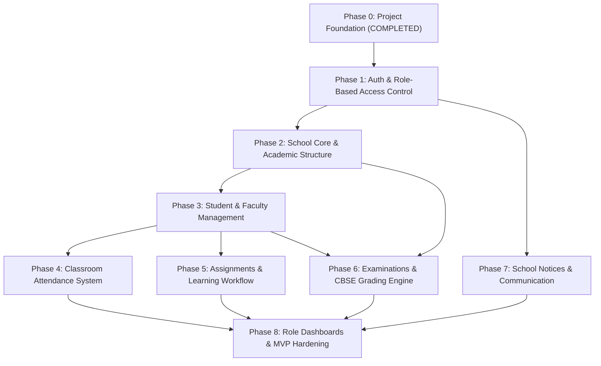

# EduNexa ERP — Development Roadmap

## 1. Overview of Phases

This roadmap outlines the systematic, phased implementation of EduNexa ERP. Each phase builds strictly upon the verified foundation of preceding milestones.

---

## 2. Phase Breakdown

### Phase 0: Project Foundation (Status: COMPLETE)
- Next.js 15 App Router, TypeScript strict, Tailwind CSS, Lucide icons.
- Feature-first modular organization.
- Supabase SSR integration layer (browser, server, admin, middleware).
- Initial schema: `schools`, `profiles`, `school_memberships`.
- PostgreSQL Row Level Security (RLS) policies and security helper functions.
- Central role definitions (Principal, Admin, Teacher, Student, Parent).
- Environment configuration with Zod validation.
- Automated testing via Vitest; linting and production build verification.

---

### Phase 1: Authentication & Role-Based Access Control (Next Milestone)
- Supabase Auth integration (Email + Password login).
- Password recovery and reset flows.
- Multi-school affiliation resolver and School Context Switcher.
- Middleware-driven route protection and automated role redirects:
  - `/principal/*`
  - `/admin/*`
  - `/teacher/*`
  - `/student/*`
  - `/parent/*`
- User profile editing and password change actions.

---

### Phase 2: School Core & Academic Structure
- School profile management and branding (logo, CBSE affiliation number, contact details).
- Academic Year management (active session, start/end dates).
- Grade/Class management (Pre-Primary through Class 12).
- Section management (Divisions A, B, C...) with Class Teacher assignment.
- Subject master (Theory, Practical, CBSE Subject Codes).
- Subject-to-Class mappings.

---

### Phase 3: Student & Faculty Management
- Student admission workflow, student profiles, admission numbers, roll numbers.
- Faculty onboarding, employee codes, department allocations.
- Teacher-Subject-Section allocation matrix.
- Parent profiles and Parent-Child linkage (`parent_student_mappings`).
- Bulk CSV import for students and faculty.

---

### Phase 4: Classroom Attendance System
- Daily attendance marking interface for class teachers (Present, Absent, Late, Half-day, Excused).
- Attendance lock-down after cutoff time with admin override.
- Monthly attendance register generation.
- Student/Parent personal attendance view and percentage calculation.
- Low-attendance alerts (< 75% CBSE requirement).

---

### Phase 5: Assignments & Homework Management
- Teacher assignment publishing (Title, Description, Due Date, Subject, Class/Section).
- Attachment support via Supabase Storage buckets.
- Student submission portal (text answers / file uploads).
- Teacher grading and feedback review.

---

### Phase 6: Examinations & CBSE Grading Engine
- Examination cycle creation (Periodic Tests, Mid-Terms, Annual Exams).
- Subject max marks and passing criteria configuration.
- Teacher marks entry sheet with auto-saving and validation.
- CBSE 8-point / 9-point grading scale calculation.
- Automated Report Card generation with student ranks and teacher remarks.
- Principal result publication control.

---

### Phase 7: School Notices & Communication
- School-wide circulars and announcements.
- Targeted notices (filtered by role or class/section).
- Urgent/Pinned notice alerts.
- Read receipts and audit trail.

---

### Phase 8: Role Dashboards & MVP Hardening
- 5 comprehensive role dashboards tailored to Google Stitch design references:
  1. Principal Executive Dashboard.
  2. Administrative Control Center.
  3. Teacher Workspace.
  4. Student Learning Hub.
  5. Parent Child Portal.
- End-to-end user testing with Playwright.
- Performance optimization and production deployment readiness.

---

## 3. Explicit Exclusions from Initial MVP
The following modules are planned for post-MVP enterprise roadmap:
- Online fee payment gateway integration (Razorpay/Stripe).
- Staff payroll and automated salary slips.
- School bus GPS transport tracking.
- Library barcode scanning and book circulation.
- Native mobile applications (React Native / Flutter).
- AI chatbot assistants and automated question paper generators.

